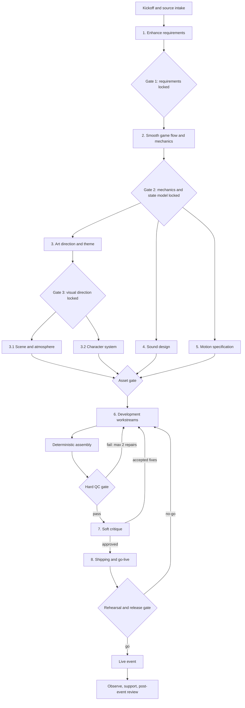

# AriSkill Skill Bingo - Agent Workflow

**Purpose:** A controlled multi-agent production workflow that turns the approved requirement into a tested, deployable synchronized web event.  
**Guiding pipeline:** Concept -> Mechanics -> Art -> Sound -> Deterministic Assembly -> Hard QC -> Soft Critique -> Release.  
**Platform decision:** This workflow does not prescribe Godot. AriSkill Skill Bingo is a realtime multi-client web experience; the 3D lecture informs the asset pipeline, assembly discipline, and quality gates only.

## 1. Operating Principles

1. **One orchestrator owns truth.** Specialist agents propose or produce artifacts; only the orchestrator updates the canonical manifest and advances a gate.
2. **Product decisions are sequential.** Requirements lock before flow; mechanics/flow lock before art and sound; runtime contracts lock before implementation assembly.
3. **Parallelize production, not unresolved decisions.** Once dependencies are locked, independent specialists may work in parallel on scene, character, sound, motion, client surfaces, backend, and QA.
4. **Documents and schemas are contracts.** Every artifact has a version, owner, inputs, outputs, validation method, and checksum where applicable.
5. **The server is authoritative.** No agent may implement client-owned time, draw, match, winner, or Float state.
6. **Assembly is deterministic.** The same approved manifests, code revision, configuration, and seed must produce the same packaged artifact and seeded test outcome.
7. **Hard gates block progress.** A soft critic advises; a hard gate fails on correctness, security, privacy, accessibility, performance budget, or missing artifacts.
8. **Retries are bounded.** A stage receives at most two repair attempts after its first submission unless the orchestrator explicitly approves a third with a recorded reason.
9. **No silent assumption drift.** Unknown product decisions are logged in `open-decisions.md` with a recommended default and owner.
10. **No auto-filled skill board.** Employees must actively select all 25 unique skills.
11. **No late scope growth.** Event-analyst/export features, emergency public-display blackout/freeze controls, profile-derived Platform/Role prefill, automatic 25-skill acceptance, and global shortcuts stay out of v1 unless the product owner explicitly reopens scope.
12. **Working UI language stays provisional.** Interface names, labels, components, and tokens remain working proposals until verified against the AriSkill design system and content review.

## 2. Workflow Map



## 3. Orchestrator Rules

### 3.1 Responsibilities

The orchestrator must:

- create the run ID and initialize the artifact manifest;
- provide each agent only approved source artifacts plus the current decision log;
- verify output format and run hard checks before accepting an artifact;
- reject outputs that alter locked rules or introduce unapproved technology/brand claims;
- maintain dependency and status fields in `artifact-manifest.yaml`;
- serialize canonical product decisions and merge parallel work only after conflict checks;
- request human approval at Gate 1, Gate 2, visual direction, security/privacy, and go-live;
- preserve provenance, license, generation prompt/script, and checksums for assets;
- stop after bounded retries and escalate with evidence and options.
- require every open decision to contain the question, recommended default, owner, and a `blocks` field naming the gate or artifact that cannot close.

### 3.2 Status vocabulary

`planned -> in_progress -> submitted -> validating -> accepted | changes_requested | blocked -> superseded`

Only `accepted` artifacts may be dependencies for the next gate. Superseded files remain traceable but are excluded from assembly.

### 3.3 Retry and escalation policy

| Situation | Action |
|---|---|
| First failed submission | Return machine-readable failures and one consolidated repair brief |
| Second failed submission | Allow one final targeted repair against the same brief |
| Failure after two repairs | Stop stage; escalate to orchestrator/human owner with evidence, impact, and 2-3 options |
| Product conflict | No retry; add to decision log and request product decision |
| Security/privacy critical issue | Freeze affected stream and assembly until approved remediation passes |
| Performance-only miss | Permit degraded mode proposal if requirements allow; otherwise block |
| Soft critic preference | Orchestrator accepts, defers, or rejects with rationale; it does not automatically block release |

## 4. Agent Input/Output Contract

Every specialist receives:

```yaml
run_id: string
stage_id: string
objective: string
locked_inputs:
  - path: string
    version: string
    checksum: string
constraints:
  - string
open_decisions:
  - id: string
    question: string
    recommended_default: string
    owner: string
    blocks: string
output_paths:
  - string
validation_commands:
  - string
acceptance_criteria:
  - string
```

Every specialist returns:

```yaml
stage_id: string
status: submitted | blocked
artifacts:
  - path: string
    type: document | schema | code | asset | test | report
    version: string
    checksum: string
inputs_used:
  - path: string
decisions_made:
  - id: string
    decision: string
    scope: provisional | final
assumptions:
  - string
tests_run:
  - command: string
    result: pass | fail
known_issues:
  - severity: critical | major | minor
    description: string
handoff_notes:
  - string
```

An agent must return `blocked`, not fabricate, when a required locked input is absent.

## 5. Artifact Manifest and Naming

### 5.1 Canonical files

The paths and extensions below are provisional workflow defaults, not stack selections. At kickoff, map them once to the verified repository conventions and record that mapping in the manifest; do not let individual agents invent alternatives.

| Stage | Canonical artifact |
|---|---|
| Source | `ariskill-skill-bingo-requirements.md` at intake; copy the accepted Stage 1 artifact to `docs/requirements/ariskill-skill-bingo-requirements.md` after repository mapping |
| Decisions | `docs/decisions/open-decisions.md`, `docs/decisions/decision-log.md` |
| Flow | `docs/ux/canonical-flow.md`, `docs/ux/state-copy.csv`, `docs/ux/wireframes/` |
| Mechanics | `contracts/round-state-machine.json`, `contracts/bingo-rules.json` |
| Art | `docs/art/art-direction.md`, `assets/manifest/assets.yaml` |
| Scene | `docs/art/scene-spec.md`, `assets/scene/` |
| Character | `docs/art/soul-system.md`, `assets/souls/` |
| Sound | `docs/audio/sound-spec.md`, `assets/audio/`, `assets/manifest/audio.yaml` |
| Motion | `docs/motion/motion-spec.md`, `tokens/motion.json` |
| API/realtime | `contracts/api-contract.yaml`, `contracts/realtime-events.json`, `contracts/projections/` |
| Code | `apps/`, `services/`, `packages/` |
| Tests | `tests/`, `reports/qa/` |
| Operations | `ops/runbook.md`, `ops/release-checklist.md`, `ops/rollback.md` |
| Assembly | `build/artifact-manifest.yaml`, `build/build-info.json` |

### 5.2 Asset manifest minimum fields

```yaml
id: soul_core_01
kind: model
source_file: assets-src/souls/soul_core_01
source_format: selected_after_stack_verification
runtime_file: assets/souls/soul_core_01
runtime_format: selected_after_stack_verification
fallback_file: assets/souls/fallback/soul_core_01
fallback_format: selected_after_stack_verification
version: 1.0.0
checksum: sha256:...
license: internal-original
generator_script: tools/assets/build_soul_core_01
bounds: [x, y, z]
pivot: [x, y, z]
triangle_count: 0
texture_memory_bytes: 0
lods: []
approved_by: null
```

Runtime assets may be generated using 3D tools/scripts, but source files and reproducible scripts must accompany runtime output. Select formats only after the existing stack and target browsers are verified; record the chosen source/runtime formats in the manifest. Do not hand-edit generated runtime files.

## 6. Stage 1 - Enhance the Requirement

### Agent role

Product Requirements Agent.

### Prompt

> Turn the approved AriSkill Skill Bingo concept into a concise, testable web-product specification. Preserve locked rules: four interfaces, employee selection of all 25 unique skills, explicit Platform and Role selection, server-randomized board positions and draws, draw-five Bingo threshold, same-draw co-winners, universal Soul reveal, and one-use Float. Identify ambiguity and propose defaults without silently changing scope. Do not add an event-analyst/export surface, profile prefill, one-click 25-skill acceptance, global shortcuts, or a public-display blackout/freeze control. Include privacy, accessibility, operations, and measurable acceptance criteria.

### Inputs

- user concept;
- locked Passes 1-3;
- organization policies and verified AriSkill design/data documentation, if provided.

### Deliverables

- canonical requirements;
- glossary, scope/non-scope, personas, business rules, exception table;
- assumption/open-decision log in which every question has a recommended default, owner, and `blocks` field;
- traceability matrix from requirement IDs to acceptance criteria.

### Hard Gate 1

- All four interfaces and end-to-end journeys are covered.
- Every business rule is testable and contradictions have explicit resolutions.
- The employee actively selects each of the 25 unique skills.
- Data/privacy/accessibility/operations constraints are present.
- Product owner explicitly locks the requirement.

## 7. Stage 2 - Design the Smooth Game Flow and Mechanics

### Agent roles

UX Flow Agent and Game Mechanics Agent. They collaborate on one canonical model; UX does not redefine mechanics.

### Prompt

> Design the lowest-friction employee, admin, public, and stage flows from the locked requirement. Produce an authoritative round/board state machine, command/event model, loading/empty/error/reconnect states, and distance-readable screen hierarchy. Optimize the 25-skill selection through discovery and fast edits while preserving active individual selection. Treat countdown zero as registration lock only; play begins through manual admin Start, while confirmed Start Now may explicitly lock and start early.

### Deliverables

- canonical journey and screen map;
- state machine and transition table;
- deterministic Bingo line and co-winner rules;
- copy catalog for normal, empty, loading, late-entry, cancelled, exhausted, reconnect, and permission states;
- low-fidelity wireframes for all four interfaces;
- analytics event dictionary and privacy-safe projection definitions.

### Hard Gate 2

- State machine has no unreachable state or illegal unhandled transition.
- Draw/winner/Float concurrency behavior is explicit.
- All exception copy has a recovery path.
- Every business rule has either explicit failure handling or a documented non-failing invariant.
- Public, stage, admin, and employee states map to one server state.
- Product, engineering, event operations, and accessibility owners approve mechanics.

## 8. Stage 3 - Design the Art Elements and Theme

### Agent role

Art Director Agent.

### Prompt

> Define a cohesive, inclusive skill-cosmos visual language for AriSkill Skill Bingo. The hierarchy must communicate belonging and discovery, not skill rank. Map only verified brand assets; label all other tokens provisional. Set budgets and handoff rules for web runtime assets and 2D fallbacks.

### Deliverables

- moodboard and art-direction document;
- provisional-to-verified design token map;
- color/type/icon/material rules;
- readability and contrast rules for mobile and venue displays;
- asset list with owners, budgets, licenses, and fallback requirements.

### Gate 3

- No visual trait implies employee capability, Role status, or rank.
- Public information safe zone and stage readability are defined.
- Brand owner approves verified mapping; provisional elements are clearly labeled.
- Accessibility and asset budgets are signed off before production assets begin.

## 9. Stage 3.1 - Design the Scene and Atmosphere

### Agent role

Environment / Realtime Graphics Agent.

### Prompt

> Design the always-live Arise Galaxy for a browser-based public display. Specify scene hierarchy, camera, lighting/materials, Soul spawn and orbit behavior, information-panel safe zone, performance levels, reduced-motion mode, 2D fallback, and deterministic asset generation/export.

### Deliverables

- scene specification and annotated compositions for Waiting, Playing, Winner;
- scene graph, camera/framing, lighting/material, spawn/orbit, and transition specs;
- source assets or reproducible generation scripts;
- optimized runtime models/textures, LODs, fallback sprites, and manifest entries;
- performance capture on target venue hardware.

### Hard checks

- Required files exist; manifests and checksums match.
- Models load, use approved formats, have valid materials/textures, sane bounds/pivots, and no missing references.
- Polygon, draw-call, texture-memory, bundle-size, and frame-time budgets pass.
- Text safe zone remains readable in all states.
- 2D and reduced-motion fallback paths work without affecting game state.

## 10. Stage 3.2 - Design the Character

### Agent role

Character System Agent.

### Prompt

> Create a modular Arise Soul system that renders stable, inclusive cosmetic variation from a server-provided seed. Selected-skill categories may affect constellation accents but never size, power, value, or rank. Define the Bingo Star as a cosmetic badge and provide accessible/fallback representations.

### Deliverables

- Soul anatomy, silhouette, palette/material, expression, constellation, and badge rules;
- deterministic parameter schema and seed examples;
- source models/art plus runtime exports, thumbnails, LODs, and fallback sprites;
- neutral test cohort showing diversity without Platform/Role stereotypes;
- asset manifest and license/provenance records.

### Hard checks

- Same seed yields the same output.
- No forbidden personal attribute is encoded or inferred.
- All combinations stay within bounds and budgets and avoid clipping.
- Badge has accessible label and does not obscure the Soul.
- Assets render in 3D, 2D fallback, reduced-motion, and high-density Galaxy modes.

## 11. Stage 4 - Design the Sound

### Agent role

Sound Designer Agent.

### Prompt

> Build a compact sound system for registration, draw tension, match, draw-five unlock, Bingo, Soul reveal, Float, error, and ambient Galaxy. Sound must reinforce visible state, work in a venue, obey browser autoplay restrictions, and fail silently.

### Deliverables

- cue sheet keyed to authoritative event types;
- final audio plus editable sources;
- mix hierarchy, ducking, loop, loudness/peak, preload, and mute rules;
- licenses/provenance and audio manifest;
- silent-mode and visual/caption equivalents.

### Hard checks

- Files decode in supported browsers, meet duration/size/loudness budgets, and have valid loop points.
- No cue is the sole carrier of information.
- Rapid events cannot create an unsafe or chaotic mix.
- Autoplay-denied, mute, missing-file, and venue-output cases pass.

## 12. Stage 5 - Design Micro-animation and Motion

### Agent role

Motion Design Agent.

### Prompt

> Specify concise motion for selection, completion, lock, draw reveal, match, Bingo line, winner, Soul reveal, and synchronized Float. Define timing/easing tokens, interruption and reconnect behavior, reduced-motion replacements, and server-timestamp synchronization.

### Deliverables

- motion state diagrams and storyboard/prototypes;
- `tokens/motion.json` with durations/easing/delays;
- event-to-animation mapping;
- interrupt/replay/reconnect and reduced-motion rules;
- frame-time budget and test cases.

### Hard checks

- Animation cannot block or mutate canonical state.
- Reconnect sets final state without replaying stale celebrations.
- Reduced-motion equivalents exist for every transition.
- No unsafe flashing or unbounded camera motion.
- Motion budgets pass on a low-end test phone and venue hardware.

## 13. Stage 6 - Development

Development begins only after Gate 2. Visual/audio implementation may proceed with approved placeholders while production assets pass their gates. Product decisions remain sequential; the following workstreams may run in parallel against versioned contracts.

### 13.1 Backend and realtime workstream

Responsibilities:

- implement the authoritative state machine, transactional lock/draw/winner/Float operations, and durable-store constraints;
- implement authentication/authorization, idempotency, version checks, audit/outbox, snapshots, realtime sequencing, and privacy-safe projections;
- implement Skill Master and Matrix adapters with versioning;
- produce API/realtime schemas and seeded deterministic fixtures.

Required tests: unit, property, state-machine, transaction/concurrency, replay, authz, projection-redaction, migration, load, and recovery.

### 13.2 Employee mobile workstream

Responsibilities:

- join/session, Platform/Role, three-mode discovery, individual 25-skill selection, autosave, board, countdown, playing, results, private Matrix insight, Soul reveal, Float;
- offline/reconnect reconciliation, responsive behavior, keyboard/screen-reader support, reduced motion, and silent operation;
- never calculate authoritative round result.

### 13.3 Admin portal workstream

Responsibilities:

- round configuration and operational Mission Control;
- safe pending/accepted/rejected command behavior, confirmation for destructive controls, stale-version recovery, cancellation reason, audit visibility;
- separate aggregate Insights; no blackout/freeze control is added.

### 13.4 Public 3D Galaxy workstream

Responsibilities:

- Waiting/Playing/Winner information panel plus persistent Galaxy;
- scene/character asset loading, instancing/LOD, Float entrance, 2D fallback, reduced motion, snapshot reconciliation, stale-state indicator;
- render only public-safe projections.

### 13.5 Stage dashboard workstream

Responsibilities:

- read-only, distance-readable presentation of round state, participation, draw/matches, winners, and approved aggregate skill insights;
- automatic mapping from authoritative round state to the stage view, without presenter-only features beyond the requested dashboard;
- no mutation credentials in the stage client.

### 13.6 Asset and audio integration workstream

Responsibilities:

- validate manifests and checksums; optimize models, textures, sprites, and audio;
- generate typed asset maps; preload critical cues; lazy-load/degrade optional assets;
- enforce license/provenance, budgets, and missing-asset fallbacks.

### 13.7 QA and reliability workstream

Responsibilities:

- build traceability from requirements to automated/manual tests;
- maintain device/browser/venue matrices and deterministic round fixtures;
- run accessibility, privacy, security, concurrency, load/soak, reconnect-storm, projection, and visual-regression suites;
- own defect severity and release evidence, independent from feature authors.

## 14. Deterministic Assembly

The Assembler Agent consumes only accepted manifest entries. It does not redesign or repair product behavior.

### Assembler prompt

> Assemble the accepted contracts, code, configuration, and optimized assets for the requested environment. Resolve inputs strictly through `artifact-manifest.yaml`; verify checksums and schema versions; generate typed asset/event bindings and build metadata; run reproducible build commands; fail on missing, stale, unlicensed, oversized, or incompatible artifacts. Do not modify source decisions or generated runtime assets by hand.

### Assembly outputs

- pinned dependency lockfiles and reproducible build instructions;
- immutable build ID with source revision, contract versions, asset hashes, and environment configuration schema;
- deployable web/server artifacts and durable-store migration bundle;
- source maps/symbols stored securely, software bill of materials, and provenance report;
- seeded demo event and expected-result fixture;
- validation report.

### Assembly hard checks

- Clean-room rebuild yields identical content hashes where tooling permits.
- Manifest contains no missing, duplicate, unapproved, or orphan runtime asset.
- Contract/client versions are compatible.
- Secrets are absent from bundles and repositories.
- Durable-store migrations upgrade and roll back in a disposable environment.
- Seeded round reproduces expected draw order, matches, and co-winners.

## 15. Hard QC Gate

Release candidates must pass all checks below; waiver requires named human approval, expiry, impact, and mitigation.

| Category | Blocking checks |
|---|---|
| Functional | Four canonical flows; state/exception coverage; draw-five rule; co-winners; Float once |
| Data | Durable-state schema/constraints/migrations; Matrix version; projection redaction; retention jobs |
| Concurrency | Duplicate/stale/simultaneous admin commands; winner atomicity; reconnect/event gaps |
| Security | Threat model; authn/authz; replay/rate-limit tests; secret/dependency scan; penetration findings |
| Privacy | Public/stage payload review; consent/name policy; deletion/retention verification |
| Accessibility | WCAG 2.2 AA checks; keyboard/screen reader; contrast/reflow; reduced motion; silent mode |
| Performance | Capacity + 50%; p95 API/draw/fan-out; reconnect; frame time; asset/bundle budgets |
| Compatibility | Supported phone/browser matrix and exact venue public/stage hardware |
| Resilience | Primary-renderer/audio/asset-delivery/realtime failure fallbacks; restart/recovery; no stale celebration |
| Operations | Dashboards/alerts/audit; runbook; backup; rehearsal; rollback and contact tree |

The machine-readable result is stored at `reports/qa/release-gate.json`; any `critical` or `major` failure blocks critique approval and release.

## 16. Stage 7 - Critique

### Agent roles

- UX Critic: comprehension, friction, copy, and recovery.
- Game Fairness Critic: eligibility, randomness, pacing, and tie handling.
- Visual/Motion Critic: hierarchy, inclusivity, atmosphere, legibility, fatigue.
- Event Operations Critic: MC control, stage narration, recovery, rehearsal.
- Red-team Critic: abuse, privacy leakage, spoofing, replay, overload.

### Critic prompt

> Review the release candidate against the locked requirement and release evidence. Separate blocking defects from preferences. For every issue provide requirement ID, reproduction/evidence, user/event impact, severity, and smallest viable correction. Do not expand scope or substitute aesthetic preference for a failed requirement.

### Output

`reports/critique/critique-round-N.md` with:

- blocking findings;
- prioritized non-blocking improvements;
- strengths to preserve;
- explicit approve / approve-with-follow-ups / reject recommendation.

Critique is a soft gate except when it reveals a hard-QC violation. The orchestrator triages once, sends a consolidated repair brief, and permits at most two correction loops before escalation.

## 17. Stage 8 - Shipping and Go-Live

### 17.1 CI pipeline

1. Format/lint/type/schema checks.
2. Unit/property/state-machine tests.
3. Contract, durable-store concurrency, and migration tests.
4. UI, accessibility, visual-regression, and asset validation.
5. Security/privacy scans and software bill of materials.
6. Production build and deterministic manifest verification.
7. Integration, load/soak, and failure-injection tests.
8. Deploy to staging; smoke test seeded event.
9. Manual release approval; deploy immutable production artifact.
10. Post-deploy smoke and monitoring confirmation.

### 17.2 Environment and release rules

- Separate development, staging/rehearsal, and production environments and credentials.
- Configuration is validated, versioned, and free of secrets in client bundles.
- Use backward-compatible API/event changes during rollout.
- Freeze non-critical changes before the dress rehearsal.
- Pre-warm/cache essential assets and verify venue DNS/network/firewall paths.
- Record exact deployed build ID, schema version, asset manifest, and operator names.

### 17.3 Event rehearsal

Run a full script on actual venue equipment:

- scan and join from multiple phone classes;
- 25-skill completion, lock boundary, late/incomplete board;
- seeded draw sequence with known same-draw co-winners;
- duplicate Next Skill click, admin refresh, Wi-Fi loss/recovery, public display refresh;
- audio muted/autoplay denied, primary-renderer failure/2D fallback, reduced-motion mode;
- Soul reveal and replayed Float request;
- cancellation, exhausted pool, reconnect/waiting-state recovery, and next-round recovery;
- stage narration, winner-name policy, and aggregate insight explanation.

### 17.4 Go/no-go checklist

- Hard QC is green and open critical/major defects are zero.
- Security/privacy/accessibility approvals are recorded.
- Capacity test and venue rehearsal meet targets.
- Admin/MC and support owners have the current runbook and have practiced recovery.
- Monitoring and alerts are live; support bridge/contact tree is confirmed.
- Rollback version is deployable; durable-store compatibility has been verified.
- Product/event owner gives explicit go.

### 17.5 Rollback and live recovery

- Prefer feature flags and traffic switchback to the last known-good compatible build.
- Never roll back across an incompatible durable-store migration; use a tested forward-fix or compatibility release.
- If gameplay integrity is uncertain, stop new commands, preserve audit state, cancel the affected round transparently through the existing state model, and follow the incident runbook.
- Do not recalculate or overwrite a published winner set. If a round is invalid, cancel it transparently and start a new round under an incident record.
- The public 3D/audio layer may be disabled independently while mobile/admin/core gameplay continues.

### 17.6 Post-event

- Review the approved aggregate Insights in their existing interface, verify retention/deletion jobs, and archive audit/release evidence; v1 does not add an export feature.
- Conduct a blameless review covering completion time, reconnects, command latency, fairness, accessibility, support incidents, and attendee feedback.
- Convert improvements into a versioned backlog; do not mutate the archived v1 requirement.

## 18. Definition of Done

The product is done for v1 only when:

- the approved requirement and traceability matrix cover all four interfaces;
- every employee must and can actively select exactly 25 unique skills;
- authoritative state, random draw, draw-five evaluation, same-draw co-winners, and one-use Float are proven under retries and concurrency;
- public and stage projections contain no private skill-gap data;
- all production assets have source/provenance, approved runtime formats, fallbacks, and passing budgets;
- supported devices, browsers, accessibility modes, public/stage hardware, audio, and failure fallbacks pass;
- capacity + 50%, security, privacy, observability, backup/recovery, and audit checks pass;
- production-like dress rehearsal is complete and the MC/support team can execute the runbook;
- an immutable release is deployed, monitored, and rollback-ready;
- product, engineering, design, security/privacy, accessibility, QA, and event operations owners have signed off.

## 19. Suggested Repository Structure

```text
/
|-- apps/
|   |-- employee-mobile/
|   |-- admin-portal/
|   |-- public-galaxy/
|   `-- stage-dashboard/
|-- services/
|   |-- game-service/
|   `-- analytics-projection/
|-- packages/
|   |-- contracts/
|   |-- design-tokens/
|   |-- game-rules/
|   `-- ui/
|-- contracts/
|   |-- api-contract.yaml
|   |-- realtime-events.json
|   |-- round-state-machine.json
|   `-- projections/
|-- docs/
|   |-- requirements/
|   |-- decisions/
|   |-- ux/
|   |-- art/
|   |-- audio/
|   `-- motion/
|-- assets-src/
|-- assets/
|   |-- scene/
|   |-- souls/
|   |-- audio/
|   `-- manifest/
|-- tools/
|   |-- assets/
|   `-- assembly/
|-- tests/
|   |-- fixtures/
|   |-- contracts/
|   |-- e2e/
|   |-- load/
|   `-- accessibility/
|-- reports/
|   |-- qa/
|   `-- critique/
|-- ops/
|   |-- runbook.md
|   |-- release-checklist.md
|   `-- rollback.md
`-- build/
    |-- artifact-manifest.yaml
    `-- build-info.json
```

This is a logical structure; adapt it to the organization's verified repository conventions.

## 20. Paste-ready Kickoff Prompt

```text
You are the Orchestrator for AriSkill Skill Bingo, a synchronized web event with four clients: employee mobile, admin portal, public Arise Galaxy screen, and stage dashboard.

Canonical requirement:
ariskill-skill-bingo-requirements.md

Your job is to run the gated workflow in ariskill-skill-bingo-agent-workflow.md. Initialize a run ID, artifact-manifest.yaml, decision log, and requirements traceability matrix. Do not begin a downstream stage until its required gate is accepted. Product decisions remain sequential. After the mechanics/state/API contracts are locked, you may run independent art, scene, character, sound, motion, backend, client, asset-integration, and QA workstreams in parallel.

Non-negotiable rules:
- Employees actively select all 25 unique skills; never add a one-click 25-skill recommendation option.
- Employees explicitly select Platform and Role; never prefill either from profile data.
- The server owns time, board randomization, draw selection, matches, winner calculation, and one-use Float consumption.
- Draws come only from active-board Core/Critical Skills, are unique per round, and Bingo evaluation starts at draw five.
- Everyone who first completes a line on the same winning draw is a co-winner.
- Every completed participant gets a non-ranking Arise Soul.
- Public/stage projections must not expose individual skill selections or Role Matrix gaps.
- The product is browser-based. Use the 3D lecture only for specialist asset artifacts, deterministic assembly, and quality-control patterns; do not assume Godot.
- Existing technology and design systems are unknown until verified. Label recommendations provisional/non-binding.
- Do not add event-analyst/export features, emergency public-display blackout/freeze controls, global shortcuts, or presenter-only Stage capabilities outside the approved dashboard.
- Countdown zero locks registration only. Admin starts play manually; confirmed Start Now may explicitly lock and start early. No skill is drawn automatically.

For each agent, issue the required input/output contract, exact artifact paths, validation commands, and acceptance criteria. Accept only manifest-listed, versioned, validated outputs. Run hard quality gates for functionality, data integrity, concurrency, security, privacy, accessibility, performance, compatibility, resilience, and operations. Allow at most two repair attempts after an initial failed submission; then escalate with evidence and options. Treat critique as advisory unless it reveals a hard-gate failure.

Finish only when the Definition of Done, production-like venue rehearsal, release approvals, observability, and rollback readiness are all satisfied. Report the final build ID, manifest hash, gate evidence, open approved waivers, and go-live decision.
```

## 21. Workflow Source Note

The supplied `Lecture_12_3d_Games.pdf` informed the Concept -> Mechanics -> Art -> Sound -> Assembly structure, specialist asset files, deterministic assembly, and hard QC approach. Its Godot-specific examples are intentionally not requirements for this synchronized browser-based event.

## 22. Pass 10 Revision and Critique Note

Pass 10 checked this workflow against the user concept and the locked requirement/logic/exception decisions.

| Severity | Finding | Workflow revision |
|---|---|---|
| Must-fix | Later stages could generate unsupported Event Analyst/export, blackout/freeze, profile-prefill, auto-selection, global-shortcut, or presenter-only capabilities. | Added explicit no-scope-growth constraints to orchestration, Stage 1, development, rehearsal, incident handling, post-event work, and the kickoff prompt. |
| Must-fix | Countdown lock and manual start were not explicit in the workflow prompts. | Made `00:00` lock-only, kept manual Start, and defined confirmed Start Now as the sole early lock-and-start path; no draw auto-fires. |
| Must-fix | Open decisions lacked a required blocking boundary. | Added `question`, `owner`, and `blocks` to the agent contract and made them a gate requirement. |
| Must-fix | The flow gate did not require failure handling for every business rule. | Added rule-level failure/non-failing-invariant coverage to Hard Gate 2. |
| Should-fix | The asset manifest and resilience checks implied unverified runtime technologies/formats. | Made artifact names/extensions provisional, deferred format choice until stack verification, and expressed fallback checks as capabilities. |
| Should-fix | Stage development implied custom presenter view controls. | Narrowed the Stage workstream to automatic, read-only presentation of the approved dashboard information. |
| Noted | Hard gates, bounded repair attempts, deterministic assembly, soft critique, shipping, rehearsal, and rollback were internally consistent. | Preserved these mechanisms unchanged. |
