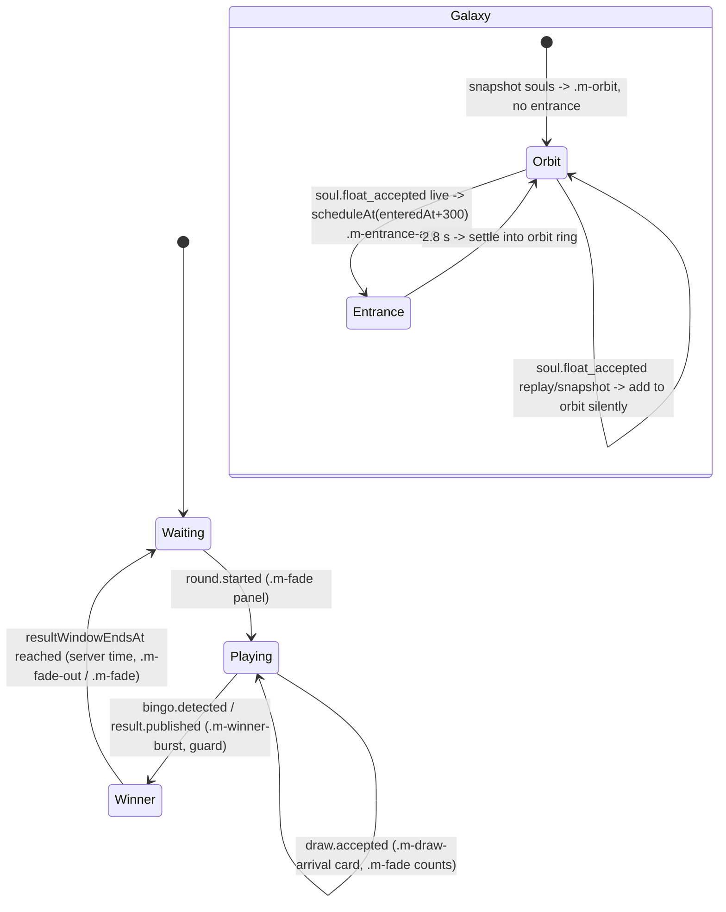

# AriSkill Skill Bingo - Motion Specification (Stage 5)

Owner: Motion Design Agent. Version 1.0.0. run_id `run-20260922-113339`, stage `5-motion`.

Inputs (locked, unmodified): requirements section 11 (motion table and rules), 9.2 (scene motion limits), 12.2 (accessibility), 15.4 (targets); `contracts/realtime-events.json` (event types, `clientRules`); `docs/ux/canonical-flow.md` (screens, section 5 recovery); `docs/ux/wireframes/README.md`; workflow section 12.

Artifacts:

| Path | Purpose |
|---|---|
| `tokens/motion.json` | Durations, easing, delays, stagger, per-interaction contract, flash-safety and frame budgets |
| `packages/ui/motion.css` | Keyframes + `.m-*` utility classes; reduced-motion replacements for every class |
| `packages/ui/motion.js` | Runtime helpers: reduced-motion, `animateOnce`, celebration guard, server-time scheduling, Float countdown, line tracing |
| `packages/ui/test/motion.test.js` | node:test suite (17 tests) |
| `docs/motion/prototypes/motion-prototype.html` | Standalone prototype of every animation with a reduced-motion toggle; screenshot in `reports/qa/motion-prototype.png` |

## 1. Principles

1. **Animation never blocks or mutates canonical state.** The app applies the server state first (classes such as `.is-matched`, `.is-locked`, `.is-on-line`, `.is-revealed`, `.is-floated`, text content), then optionally calls `animateOnce`. Every helper returns synchronously and only toggles CSS classes / custom properties.
2. **Final state lives on persistent classes, never on the animation.** Removing an `.m-*` class (end, cancel, timeout, reconnect) leaves the correct final state.
3. **Celebrate once, live only.** `createCelebrationGuard().shouldCelebrate(key, { epoch, sequence, replay })` gates every celebration (draw arrival, match pulse, line trace, winner burst, Soul reveal, Float launch, Galaxy entrance). Replays, snapshot-derived state and events from a previous connection epoch set the final state silently.
4. **Server time drives coordinated cues.** Float countdown and Galaxy entrance use `scheduleAt` with a server-aligned clock (`makeServerClock(offsetMs)` from `/time` or the response envelope `serverTime`). Animation may interpolate but never invents game state.
5. **Compositor-only.** Only `transform`, `opacity`, small `box-shadow`/`outline-color` changes and SVG `stroke-dashoffset` animate. No layout properties. Layout stays stable while chips are added/removed.
6. **Accessible by default.** Every `.m-*` class has a reduced-motion replacement (fade or static end state) that is active both under `prefers-reduced-motion: reduce` and under the in-app toggle `data-reduced-motion="true"`. Nothing flashes above 3 Hz; nothing relies on motion alone (copy/live regions carry the meaning per 12.2).

## 2. Tokens (`tokens/motion.json`)

| Group | Values |
|---|---|
| durations (ms) | instant 0, fast 120, base 180, medium 280, slow 400, reveal 800, soulReveal 2000, celebrate 1000 |
| easing | standard `cubic-bezier(0.2,0,0,1)`, emphasized `cubic-bezier(0.3,0,0,1)`, exit `cubic-bezier(0.4,0,1,1)`, linear |
| delays (ms) | matchAfterDraw 200, lineTraceAfterMatch 350, winnerTextReady 280, floatPublicOffset 300 |
| stagger (ms) | gridCell 20, lineCell 120 |
| flashSafety | maxFlashesPerSecond 3, maxLuminanceDeltaPercent 10, maxFlashAreaPercentOfViewport 25, noSaturatedRedFlash |
| budgets | frameMsMobile 16.7, frameMsVenue 16.7, minFpsVenue 30, maxConcurrentAnimatedElements mobile 30 / venue 200 |

CSS exposure: `motion.css` sets `--motion-*` custom properties on `:root`; `--motion-fast/base/slow` and `--motion-ease-standard` alias to the art agent's `--duration-*` / `--ease-standard` tokens via `var(--duration-fast, 120ms)` so the values follow `packages/design-tokens/tokens.css` when it is loaded and fall back to `motion.json` when it is not. Two values are deliberately literal: `--motion-ease-emphasized` stays `cubic-bezier(0.3,0,0,1)` because `tokens.css` defines an overshooting `--ease-emphasized` (…,1.2) that would push lock/draw motion past its end bounds, and `--motion-reduced-fade: 180ms` is used for every reduced-motion fade because `tokens.css` zeroes `--duration-*` under `prefers-reduced-motion`, which would make replacements instant rather than perceptible. Every requirement-bound interaction uses its own literal (`--motion-add`, `--motion-lock`, …) so the tokens.css values (fast 150 / base 250 / slow 600) can never push an interaction outside its required range.

### Interaction contract vs requirement 11

| Interaction | Requirement | Token | Class | Reduced |
|---|---|---|---|---|
| Add skill | 120-180 ms scale/fade, stable layout | 150 ms standard | `.m-add` | fade |
| Remove skill | 120-180 ms | 150 ms exit | `.m-remove` | fade |
| Board completion | ordered glow <= 800 ms | 24 x 20 ms stagger + 300 ms = 780 ms | `.m-board-complete` (+`--i`) | static-glow |
| Board lock | border seal + label <= 400 ms | 400 ms emphasized | `.m-lock`, `.m-lock-label`, final `.is-locked` | static-border |
| Draw arrival | card reveal then matching cells | 400 ms, matches after 200 ms | `.m-draw-arrival` | fade |
| Match | 200-350 ms glow/pulse, final state stays | 300 ms; final `.is-matched` | `.m-match` | static |
| Bingo line | trace once, no loop | 350 ms delay + 5 x 120 ms steps (320 ms each) = ~1.2 s; `iteration-count: 1` | `.m-line-trace` (+`.is-on-line`, `--line-i`) | static-outline |
| Winner view | restrained burst, readable within 1 s | 1000 ms burst, text visible by 280 ms | `.m-winner-burst`, `.m-winner-text`, `.m-winner-halo` | fade |
| Soul reveal | 1.5-2.5 s staged, skippable after first view | 2000 ms: glow 0-700, silhouette 600-1400, features 1300-2000 | `.m-soul-reveal` (+ child parts), final `.is-revealed` | fade |
| Float | 3 -> 2 -> 1 -> FLOAT, launch ack, public entrance | stepMs 1000, tick 600 ms, launch 600 ms, public offset 300 ms | `.m-float-countdown .m-float-digit`, `.m-float-launch` | fade |
| Galaxy entrance | edge -> short arc -> pulse -> stable orbit | arc 1800, pulse 400, settle 600 | `.m-entrance-arc` then `.m-orbit` | fade, static orbit |
| Orbit / camera | slow, bounded | 6 deg/s max angular speed (60 s period), camera drift <= 12 px/s, yaw <= 8 deg | `.m-orbit` | static |
| Ambient pulse | calm continuity | 2.4 s period (0.42 Hz), opacity 0.82-1 | `.m-pulse-soft` | static |

## 3. Motion state diagrams per surface

### 3.1 Employee mobile

```mermaid
stateDiagram-v2
  [*] --> Selecting: E3
  Selecting --> Selecting: tap add / remove\n.m-add / .m-remove (150 ms)
  Selecting --> Ready: 25th selected -> board.ready\n.m-board-complete (780 ms, guard)
  Ready --> Selecting: Edit skills (no motion; warning copy)
  Ready --> Locked: round.locked / board.locked_active\n.is-locked + .m-lock (400 ms)
  Locked --> Playing: round.started (.m-fade panel)
  Playing --> Playing: draw.accepted\n.m-draw-arrival (400) -> +200 ms .is-matched + .m-match (300)
  Playing --> Result: result.published\n.is-on-line + .m-line-trace (once) -> .m-winner-burst (1 s) or result copy fade
  Result --> SoulReveal: Reveal Soul / soul.created\n.m-soul-reveal (2 s, skippable after first view)
  SoulReveal --> ReadyToFloat: tap READY TO FLOAT
  ReadyToFloat --> Floating: runFloatCountdown 3-2-1-FLOAT (server clock)\nsoul.float command on FLOAT
  Floating --> Floated: soul.float_accepted\n.m-float-launch (600 ms) -> .is-floated
  Floated --> [*]
  note right of Playing: any state: reconnect -> snapshot -> final classes only, guard epoch bumped
```

### 3.2 Public event screen (Galaxy + info panel)



### 3.3 Admin portal

Mission Control uses only `.m-fade` for panel/state changes and count updates and `.m-draw-arrival` for the accepted-draw row. No celebration classes: the admin needs stable, immediately readable state. Pending/accepted/rejected command state is shown with copy + colour + icon, never motion alone.

### 3.4 Stage dashboard

Read-only, distance-legible. `.m-fade` on tile value changes (180 ms) and `.m-draw-arrival` on the current-draw strip. Winner list uses `.m-fade`; no burst, no trace (the public screen carries the spectacle, requirement 4.4).

## 4. Storyboards

**Add / remove skill (E3).** Tap a skill: the new chip appears in the next slot scaling from 92 % with opacity 0 -> 1 in 150 ms; the count `17 / 25` updates immediately (before the animation). Remove: chip scales to 92 % and fades in 150 ms with `pointer-events: none`, then is removed from DOM by `onEnd`. Layout for siblings is not animated (no reflow tricks); the list simply reflows once on removal.

**Board completion (E3 -> E4).** On `board.ready` the grid receives `.is-complete` and the 25 shuffled cells render at once (state first). Then `.m-board-complete` plays a wave: each cell's box-shadow swells to 3 px and fades, starting at `--i * 20 ms`, row-major from top-left; total 780 ms. Copy `Your Skill Bingo is ready!` is present from frame 0. Sound: `registration_ready`.

**Board lock (E4 -> E5).** On `round.locked`/`board.locked_active` the grid gets `.is-locked` (2 px outline) and the lock label is shown; `.m-lock` animates the outline from 6 px offset to 0 (seal) while the label fades up; 400 ms. Countdown text changes to `Locked` immediately.

**Draw arrival (E6 / public Playing).** On `draw.accepted` the draw number, kind and name are set in the DOM, then `.m-draw-arrival` lifts the card 12 px -> 0 with a fade (400 ms). After 200 ms, every `myMatchedPositions` cell gets `.is-matched` and (guarded) `.m-match`: 4 % scale pulse with a glow ring, 300 ms. Draw 5 also swaps the pacing line to `Bingo is live` (copy + `.m-fade`, sound `draw5_unlock`). Sound: `draw_reveal`, then `cell_match` (rate-limited, one cue per draw regardless of how many cells match).

**Bingo line (E7).** On `bingo.detected` + `result.published` (`myResult.lineIds`) the winning cells get `.is-on-line` and `--line-i` 0..4 via `markLine`; the grid gets `.m-line-trace`. Cells light in order (row: left -> right, column: top -> bottom, diagonals from the top corner) every 120 ms after a 350 ms hold; each cell scales 3 % once. An SVG overlay may instead use `path.m-line-trace` with `stroke-dashoffset` (`--line-length`). Both trace exactly once. If several lines complete on the same draw, trace the first line id only; the others receive `.is-on-line` statically.

**Winner view (E7 / public Winner).** Panel text (`Bingo!`, round, co-winner labels) is set first. `.m-winner-burst`: container settles from 96 % -> 101 % -> 100 % over 1 s while a soft radial halo (max 35 % opacity) expands and fades; the text fades in within 280 ms so it is readable well within 1 s. No confetti, no strobing.

**Soul reveal (E8).** The Soul container renders hidden parts; `.m-soul-reveal` stages them: glow blooms (0-700 ms), silhouette rises 8 px into place (600-1400 ms), features/constellation glyphs fade in (1300-2000 ms). `onEnd` adds `.is-revealed`. A Skip control appears after the first complete view (persisted per soulId); skipping removes the class and adds `.is-revealed`. Sound: `soul_reveal`.

**Float (E9 -> E10, public entrance).** Tap `READY TO FLOAT` -> `runFloatCountdown({ startAt: serverNow + 200 })` shows 3, 2, 1 each with `.m-float-digit` (600 ms scale-in), then `FLOAT`; the client issues `soul.float` at FLOAT. On `soul.float_accepted` (HTTP response or SSE) the phone plays `.m-float-launch` (rise 48 px + fade, 600 ms) and settles on `Your Soul is in the Galaxy` (`.is-floated`). Sounds: `float_countdown` per tick, `float_launch` at launch.

**Galaxy entrance (public).** At `entrance.enteredAt + 300 ms` (server clock) the Soul enters from `entrance.edge` (`setEntranceEdge`), travels a short arc lifting 40 px at mid-path (1.8 s), pulses once (6 % scale, +8 % brightness, 400 ms), settles (600 ms) and is re-parented onto an orbit ring (`.m-orbit`, 60 s period). WebGL renderer: same timings and bounds; `.m-entrance-arc` is the Canvas-2D/static fallback.

## 5. Event-to-animation mapping

| Event type | Surface | State applied first | Class / function | Reduced replacement | Sound cue | Guarded |
|---|---|---|---|---|---|---|
| `board.saved` | participant | chips, count | `.m-add` / `.m-remove` on the changed chip (local tap, not on event) | fade | none | no |
| `board.ready` | participant | 25 cells, `.is-complete` | `staggerIndex(grid)` + `animateOnce(grid,'m-board-complete',{durationMs:780})` | static-glow | `registration_ready` | yes (key `board.ready:<boardId>:<version>`) |
| `board.deferred` | participant | E5 copy | `.m-fade` | fade | none | no |
| `round.locked`, `board.locked_active` | participant | `.is-locked`, label | `animateOnce(grid,'m-lock',{durationMs:400})` | static-border | none | no (idempotent visual) |
| `round.locked` / `round.started` / `round.closed` / `round.cancelled` / `round.exhausted` | public, stage, admin | panel state, copy | `.m-fade` | fade | none | no |
| `draw.accepted` | participant | draw text, `.is-matched` via `applyMatch(cell,{celebrate})` | `.m-draw-arrival` (400) -> +200 ms `.m-match` (300) | fade / static | `draw_reveal`, `cell_match` (if any match), `draw5_unlock` (number 5) | yes (`draw:<drawId>`) |
| `draw.accepted` | public | draw card, counts | `.m-draw-arrival`, `.m-fade` on counts | fade | `draw_reveal` | yes |
| `draw.accepted`, `draw.match_counts_updated` | stage, admin | numbers | `.m-fade` | fade | none | no |
| `bingo.detected` | participant | `Bingo detected` copy | (wait for `result.published` for line ids) | - | `bingo` | yes (`bingo:<roundId>:<drawNumber>`) |
| `bingo.detected` | public | `Bingo!` | `.m-winner-burst` on panel | fade | `bingo` | yes |
| `result.published` | participant | result copy, `markLine(cells, lineIds[0])`, other lines `.is-on-line` | `.m-line-trace` (once) then `.m-winner-burst` on result card | static-outline / fade | none (bingo already played) | yes (`result:<roundId>`) |
| `result.published` | public | winners, round | `.m-winner-burst` if not already played for this round | fade | none | yes |
| `result.published` | stage | winner list | `.m-fade` | fade | none | no |
| `soul.created` | participant | Soul parts rendered | `.m-soul-reveal` (2000) -> `.is-revealed` | fade | `soul_reveal` | yes (`soul:<soulId>`) and "first view" persisted |
| user tap READY TO FLOAT | participant | - | `runFloatCountdown` + `.m-float-digit` per tick | fade | `float_countdown` | n/a |
| `soul.float_accepted` (response or event) | participant | `.is-floated`, copy | `.m-float-launch` (600) | fade | `float_launch` | yes (`float:<soulId>`); `replay:true` responses never celebrate |
| `soul.float_accepted` | public | Soul added to scene list | `scheduleAt(entranceStartMs(env), clock, ...)` -> `.m-entrance-arc` -> `.m-orbit` | fade in place | `float_launch` (venue mix) | yes (`float:<soulId>`) |
| `soul.float_accepted` | stage, admin | Galaxy count | `.m-fade` | fade | none | no |
| `participation.updated` | public, stage, admin | counts | `.m-fade` | fade | none | no |
| `system.snapshot_required`, sequence gap, reconnect | all | snapshot -> final classes | `guard.markSnapshotApplied(snapshot.sequence)`; no `.m-*` classes | - | none | - |

Sound pairing: cue ids `registration_ready`, `draw_reveal`, `cell_match`, `draw5_unlock`, `bingo`, `soul_reveal`, `float_countdown`, `float_launch` are triggered by the same guarded decision as the animation (`shouldCelebrate` true -> play cue + animate; false -> neither). Sound never carries required information (requirement 10).

## 6. Interruption, replay and reconnect rules

1. **State first.** Handlers apply the projection (text, `.is-*` classes) synchronously, then call motion helpers. If motion throws or is unsupported, state is already correct.
2. **Interruptions.** A new event for the same element cancels the previous `animateOnce` (call its cancel fn) and applies the new final state; e.g. two draws within 400 ms: the second `.m-draw-arrival` restarts, `.is-matched` accumulates. Navigation away, tab hidden (`visibilitychange`), or unmount: cancel all pending timers (`cancel()` returns from `scheduleAt`/`runFloatCountdown`).
3. **Replay / resume.** SSE resume (`since=` / `Last-Event-ID`) replays events with `sequence > since`. The sse-client marks these `replay: true` for events delivered before the first live heartbeat after (re)connect, or the app passes the epoch in which the event arrived; either way `shouldCelebrate` returns false and only final state is applied.
4. **Snapshot.** After any snapshot the app calls `guard.markSnapshotApplied(snapshot.sequence)`; every event with `sequence <= snapshot.sequence` renders final state without celebration. A `soul.float_accepted` that already happened renders the Soul in orbit with no entrance (public `galaxy.souls` from snapshot -> `.m-orbit` only).
5. **Reconnect.** `connectionEpoch` (from `packages/ui/sse-client.js`: `client.connectionEpoch`, and `meta.connectionEpoch` / `meta.replay` on every `onEvent`) increments on every (re)connect. `shouldCelebrate` accepts the sse-client meta object directly (`epoch` or `connectionEpoch`, plus `replay`). Events carry the epoch in which they were received; celebrations from an older epoch are refused. Keys are remembered so a duplicate delivery of the same eventId never re-celebrates. The reconnect banner (E12/E7 copy) uses `.m-fade` only.
6. **HTTP replays.** `soul.float` with `replay: true` in the response sets `.is-floated` without `.m-float-launch`. Admin `round.draw.next` stale (409) shows the E10 toast with `.m-fade` and never animates a draw.
7. **Result window.** Public Winner -> Waiting transition is scheduled with `scheduleAt(resultWindowEndsAt, clock, ...)`; if `round.closed` arrives earlier it wins and the timer is cancelled.
8. **Reduced motion toggle mid-animation.** Setting `data-reduced-motion="true"` swaps running animations to their reduced rule instantly (CSS cascade); no JS work needed.

## 7. Server-timestamp synchronization (Float)

- Clock: each client keeps `offsetMs = serverTime - clientNow` from `GET /time` (`epochMs`) and refreshes it from every response envelope `serverTime`; `makeServerClock(offsetMs)` provides `clockNow()`. BR-19: if the offset is unusable, show E7 and do not run coordinated cues.
- Phone countdown: `runFloatCountdown({ startAt: clockNow() + 200, stepMs: 1000 })` -> ticks at start, +1000, +2000; FLOAT at +3000, at which point the client POSTs `soul.float`. Late arrival (app resumed mid-countdown) shows only the current digit; a fully elapsed countdown launches immediately.
- Public entrance and phone acknowledgment: both key to `payload.entrance.enteredAt` (fallback `occurredAt`) + `delays.floatPublicOffset` (300 ms, configurable per venue to absorb SSE fan-out p95 <= 1 s). `entranceStartMs(envelope)` computes it; `scheduleAt` fires with `lateMs` if the event arrived after the target (it then starts immediately rather than being skipped, so the Soul always appears).
- Countdown drift target: <= 250 ms between healthy clients (15.4) - satisfied because all timers are absolute server times, not relative `setTimeout` chains.
- One entrance per Soul: guarded by key `float:<soulId>` and by the server's atomic token consumption (P-05, 15.1).

## 8. Photosensitivity rules and test method

Rules (WCAG 2.3.1 / 2.3.3 and `flashSafety`):

- No element flashes more than 3 times per second; the only repeating animations are `.m-pulse-soft` (0.42 Hz, opacity 0.82-1) and `.m-orbit` (rotation, no luminance change).
- One-shot pulses (`.m-match`, `.m-board-complete`, `.m-winner-halo`, `.m-entrance-pulse`) change luminance of the affected surface by <= 10 % (glow rings and low-opacity halos, never full-fill colour swaps) and never cover more than 25 % of the viewport at once.
- No saturated red flashes; no full-screen white flashes; no strobing on the venue screen.
- Camera: bounded drift (<= 12 px/s), yaw (<= 8 deg), no shake, no rapid parallax (9.2).

Test method (run before each event rehearsal):

1. Record 10 s of the prototype "Play all" and of the public screen Winner + Float sequence at 60 fps (Chrome `--screenshot` sequence or screen recording).
2. Run the recording through PEAT (Trace Center Photosensitive Epilepsy Analysis Tool) or an equivalent Harding-style flash analyzer; pass criterion: no flash warnings, no red flash warnings.
3. Automated: `packages/ui/test/motion.test.js` asserts that only `.m-orbit` and `.m-pulse-soft` are infinite and that `pulseSoft.periodMs` keeps the rate under 3 Hz; a reviewer greps keyframes for `background`/`filter` swings above the stated limits.
4. Manual: reduced-motion toggle on the venue screen and on a phone; confirm every interaction resolves to its static end state with no travel/burst.

## 9. Frame-time budgets and test matrix

Budgets (`budgets` in tokens): 16.7 ms per frame (60 fps target) on both mobile and venue; venue minimum 30 fps at the expected Soul count with LOD degradation; at most 30 concurrently animated DOM elements on mobile (a full grid wave is 25) and 200 on the venue display (beyond that, the Galaxy renderer batches into aggregate clusters, 9.2).

| Device class | Scenario | Pass criterion |
|---|---|---|
| Low-end Android (e.g. 4 GB, Chrome, 3x CPU throttle in DevTools) | 25 adds/removes, board completion wave, 12 draws with matches, line trace + winner, Soul reveal, Float countdown | no frame > 33 ms during animations; long tasks < 50 ms; no layout thrash (Performance panel: 0 forced reflows from motion) |
| iPhone SE class (Safari) | same sequence with `prefers-reduced-motion` on and off | same; reduced mode has zero `transform` animations |
| Venue PC (WebGL2, 1080p/4K) | 300 Souls in orbit + 5 entrances in 10 s + Winner burst | >= 30 fps min, 60 fps median; entrance starts within 250 ms of `enteredAt + offset` across two displays |
| Venue fallback (Canvas 2D / static) | same | >= 30 fps; `.m-entrance-arc` DOM path <= 20 concurrent Souls animating |
| Stage display | 20 count updates/s burst | text remains legible; `.m-fade` only |

Measurement: Chrome DevTools Performance (frames, long tasks), `client.renderer_mode` telemetry (`fps`), and `requestAnimationFrame` sampling in the public app during rehearsal (15.3 metric "renderer frame rate").

## 10. Prototype

`docs/motion/prototypes/motion-prototype.html` imports `../../../packages/ui/motion.css` and `../../../packages/ui/motion.js`, demonstrates every class with buttons (including "same draw via replay" and "from snapshot" paths that prove no celebration), and has a reduced-motion toggle wired to `setReducedMotion`. Screenshots: `reports/qa/motion-prototype.png` (exact stage command, CSS-only render) and `reports/qa/motion-prototype-modules.png` (same page with `--allow-file-access-from-files --virtual-time-budget=3000`, modules running, full height). Note: Chrome blocks ES module imports over `file://` unless launched with `--allow-file-access-from-files`; the static CSS states render either way, the buttons need that flag or an HTTP server (e.g. `npx serve` is not allowed - use `python3 -m http.server` from the repo root).

## 11. Handoff: motion.js API

```js
import {
  MOTION, EVENT_MOTION, LINE_POSITIONS,
  prefersReducedMotion, setReducedMotion, restoreReducedMotion,
  animateOnce, applyMatch, staggerIndex, markLine, lineTracePositions,
  createCelebrationGuard, scheduleAt, runFloatCountdown, makeServerClock, entranceStartMs, setEntranceEdge,
} from '/packages/ui/motion.js';

const guard = createCelebrationGuard({ getConnectionEpoch: () => sse.connectionEpoch });
// after every snapshot fetch (gap, system.snapshot_required, reconnect):
guard.markSnapshotApplied(snapshot.sequence);
// sse-client onEvent(envelope, meta) with meta = { id, type, connectionEpoch, replay, gap }
function onEvent(env, meta) {
  if (env.type !== 'draw.accepted') return;
  render(env);                                                   // state first
  const live = guard.shouldCelebrate(`draw:${env.payload.draw.drawId}`, { ...meta, sequence: env.sequence });
  if (live) animateOnce(card, 'm-draw-arrival', { durationMs: MOTION.interactions.drawArrival.ms });
  setTimeout(() => positions.forEach(p => applyMatch(cells[p], { celebrate: live })), live ? MOTION.delays.matchAfterDraw : 0);
}
```

All helpers return a cancel function and never await anything.
